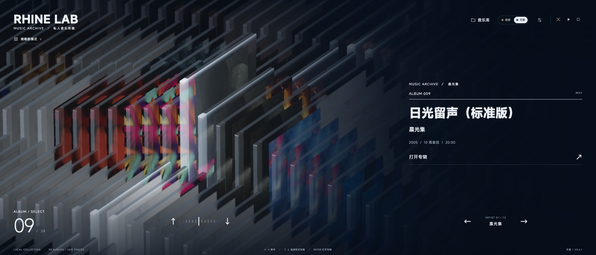
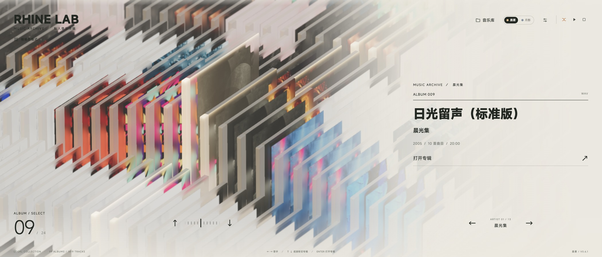
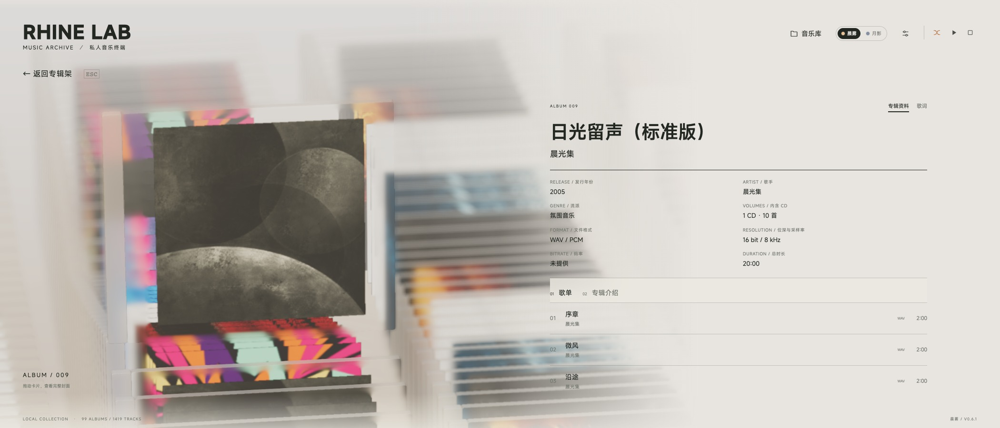
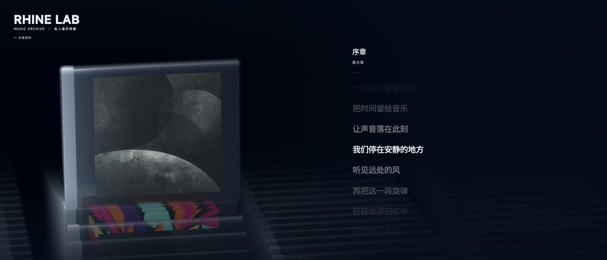
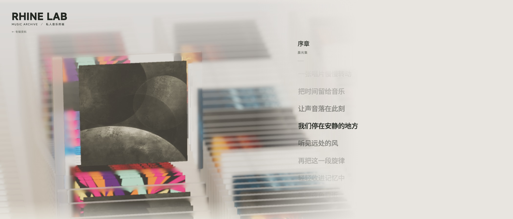
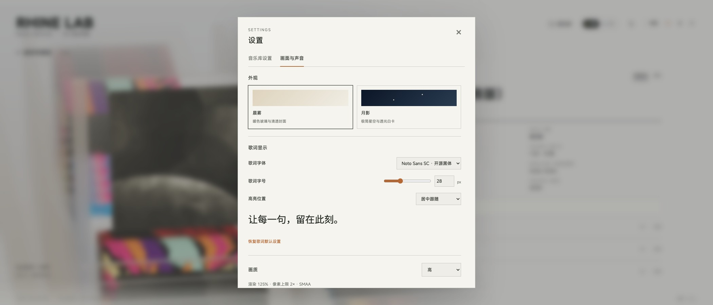

# Rhine Music · V0.6.1

**把本地音乐放进三维专辑架，一张一张，慢慢听。** 用玻璃 CD 盒浏览收藏，打开专辑、查找歌曲，在浏览器中播放自己的音乐与同步阅读歌词。

**V0.6.1 · 2026-10-24** 新增沉浸歌词视图、独立歌词字体与字号设置，优化横屏详情排版、晨雾遮罩及动画衔接，并清理开发调试入口。完整变化见 [更新日志](CHANGELOG.md)。

本版为 **macOS 本地源码发行版**，由本机 Node.js 服务与浏览器共同运行。下载后需要安装依赖并构建；不是 `.app` 安装包，不附带歌曲，普通使用无需 Blender。

音乐适配与维护：[RonaldDeng](https://github.com/RonaldDeng) · 基于 [LBEILC / RhineLabUI](https://github.com/LBEILC/RhineLabUI)

**[下载 V0.6.1 macOS 源码包](https://github.com/RonaldDeng/Rhine-Music-Demo/releases/download/v0.6.1/Rhine-Music-Demo-v0.6.1-macOS.zip)** · [Release](https://github.com/RonaldDeng/Rhine-Music-Demo/releases/tag/v0.6.1) · [SHA-256 校验](https://github.com/RonaldDeng/Rhine-Music-Demo/releases/download/v0.6.1/SHA256SUMS.txt) · [发布说明](docs/RELEASE-V0.6.1.md) · [验证与限制](docs/REVIEW-V0.6.1.md) · [版权与来源](NOTICE.md)



*V0.6.1 实际界面 · 2100 × 900。沿用 V0.5.0 的 18 张 AI 生成抽象封面与虚构演示专辑，全部配图均从本版生产构建重新截取。歌词为原创演示文字，播放验证使用零音量合成 WAV，不包含私人歌曲或第三方歌词。[配图说明](docs/media/v0.6.1/README.md)*

<details>
<summary>查看晨雾主题</summary>



*V0.6.1 实际界面 · 晨雾与月影共用专辑盒、收藏与浏览位置。*

</details>

## 开始使用

### 准备运行环境

| 依赖 | 用途 |
| --- | --- |
| [Node.js](https://nodejs.org/) ≥ 22.12.0，含 npm | 启动本机服务，安装依赖并构建界面。 |
| 支持 WebGL 2 的现代浏览器 | 显示三维专辑架；默认使用浏览器音频输出。 |
| FFmpeg 与 ffprobe | 多格式解码与无缝播放，包括 APE、WavPack 和 DSD 转 PCM；需自行安装。 |
| Apple Command Line Tools，含 `swiftc` | 使用 Mac 原生 CoreAudio 输出时需要；首次使用会在本机编译音频桥接程序。 |

可用 `node --version`、`npm --version`、`ffmpeg -version`、`ffprobe -version` 和 `swiftc --version` 检查依赖。Apple Command Line Tools 可通过 `xcode-select --install` 安装。缺少音频依赖时，设置会显示原因；浏览器仍可尝试直接播放自身支持的原始文件。

### 启动与添加音乐

1. 下载源码包，完整解压后进入 `V0.6.1` 文件夹。
2. 双击 **[启动音乐播放器.command](启动音乐播放器.command)**。首次启动会联网安装锁定依赖并构建界面，随后打开默认浏览器；日常启动复用有效构建及同一工程已有的服务。
3. 打开“**设置 → 音乐库设置 → 文件夹与扫描**”，填写音乐文件夹的绝对路径，例如 `/Users/你的用户名/Music`，保存并扫描。

尚未添加音乐时，可选择“先查看演示封面”，或运行 [tools/launchers/启动演示.command](tools/launchers/启动演示.command)。内置演示只有三张封面，没有可播放曲目；README 配图使用另一套 V0.5.0 演示专辑素材。

<details>
<summary>从终端启动或排查双击启动问题</summary>

在工程目录运行：

```sh
bash "启动音乐播放器.command"
```

若执行权限丢失，先运行 `chmod +x "启动音乐播放器.command"`。找不到 Node.js / npm 时，安装符合版本要求的 Node.js，再重新打开终端。

也可以启动前台服务：

```sh
npm ci
npm run build
npm run music -- --port 5175
```

打开终端显示的本机地址，通常为 [http://127.0.0.1:5175/](http://127.0.0.1:5175/)。前台服务用 `Ctrl+C` 停止。

双击启动器从 5175 开始寻找可用端口，启动后台服务；关闭浏览器或终端不会停止它。日志位于数据目录的 `player-service.log`。更新前可在 macOS“活动监视器”退出此工程对应的 Node 音乐服务进程。

`npm run dev` / `npm run preview` 只提供前端，不能替代本地音乐服务。

</details>

## 专辑、歌曲与歌词



*横屏资料区整体左移，晨雾遮罩采用已确认的布局；专辑资料与歌词可在同一详情页切换。*

| 功能 | 使用方式 |
| --- | --- |
| 专辑架与详情 | 按流派、歌手或专辑名排列，用方向键、底部滑尺或滚轮浏览。打开专辑查看曲目、介绍和制作信息，点击歌曲播放。 |
| 缩略图总览 | 按 `V` 或点击“缩略图模式”。横屏默认显示随专辑列定位的名牌；竖屏显示完整歌手网格。设置可开启“所有比例使用歌手网格”。选择歌手返回近景，不自动播放。 |
| 真实专辑列 | 设置 → 音乐库设置 → 排列与浏览。真实列每张专辑只出现一次，列内首尾停止；默认“填充画面”保留重复铺满与循环浏览。每列浏览位置默认记忆。 |
| 音乐库与歌曲定位 | 主屏“音乐库”或 `/` 可查找专辑、歌曲及流派。选择结果、点击右上播放歌名都可定位相应曲目，不改变播放状态。 |
| 歌词视图 | 打开专辑后切换“歌词”，按曲目查看行同步歌词，播放时高亮并自动跟随。手动滚动可暂停跟随，点击“回到当前歌词”恢复；当前歌曲的时间行可点击跳转。左上“专辑资料”或 `Esc` 返回资料页。 |
| 歌词显示 | 设置 → 画面与声音 → 歌词显示。字体、18–48 px 字号及高亮位置独立保存；可居中跟随，或固定在歌名下方第一行。默认本地内置 Noto Sans SC，也可选 MiSans、系统字体或已安装字体。 |
| 主题与动效 | 晨雾／月影、统一动画速度、减少动态效果、可跳过和重播的七秒开场。歌词字体设置不改变主界面、歌名、歌手及专辑资料的原有排版。 |
| 音频输出 | 设置 → 画面与声音 → 音频输出，可选择浏览器或 Mac 原生 CoreAudio，并选择原生输出设备。 |
| 专辑资料 | 可手动查询专辑介绍和制作人员，保存来源。自己的 AI 补介绍工作流提供任务导出、JSON 预览、冲突核对与备份导入，见[使用说明](docs/album-introductions/README.md)。 |

### 歌词从哪里来



<details>
<summary>查看晨雾歌词视图</summary>



</details>

优先读取与音频同目录、同文件名的 `.lrc` 或 `.txt`，以及音频内嵌歌词。缺少本地同步歌词时，按当前曲目自动查询在线来源；查询只发送匹配所需的曲名、歌手等元数据，不上传音频、不修改歌曲或标签。失败时保留可用的本地纯文本，“重新查找”可重试未命中的曲目。

歌词采用**逐行同步**；是否有歌词、译文与时间戳取决于本地文件或上游来源。在线服务的开源许可不等于歌词文本的版权许可，本项目不随源码分发第三方歌词正文。具体接口、署名和使用边界见 [歌词来源说明](docs/LYRICS.md) 与 [NOTICE](NOTICE.md)。

### 设置与快捷键

“音乐库设置”管理文件夹、扫描、排列、专辑介绍、制作信息和资料来源；“画面与声音”管理外观、动画、歌词显示、声音及输出设备。标题与页签固定，内容单独滚动；同一次打开设置期间换页保留输入、预览和滚动位置。

<details>
<summary>查看歌词显示设置</summary>



</details>

| 操作 | 功能 |
| --- | --- |
| `← / →` | 切换分类或歌手列。 |
| `↑ / ↓`、专辑架上的上下滚轮 | 浏览当前列；详情中方向键可直接换片。 |
| `Enter` | 打开当前专辑。 |
| `Space` | 播放／暂停；尚未选曲时播放当前专辑。 |
| `/` | 打开音乐库搜索。 |
| `V` | 进入或退出缩略图总览。 |
| `Esc` | 关闭弹窗、退出歌词／总览或返回专辑架。 |
| 拖动详情中的 CD 盒 | 旋转查看封面与盒体。 |

输入框内不触发曲库导航快捷键；设置和详情正文保留自身滚动。

### 歌曲衔接与格式

“播放与声音”提供“淡出但不淡入 / 淡出淡入 / 无缝播放”，默认淡出淡入。手动切歌时每段淡变约 450ms，两首歌不叠播；自然播完不提前淡出尾段。无缝播放按音频时钟提前准备并接续下一首，保留源文件本身的静音。准备不及时、内存预算不足或格式不兼容时，会提示并退回普通切换。歌曲、氛围配乐和界面音效分别控制。

可扫描 APE、WavPack、WMA、FLAC、WAV、M4A／MP4、ALAC、DSF／DFF、MP3、AAC、AIFF／AIF、OGG 和 Opus。**可索引不代表所有编码都能播放**，实际支持取决于编码、本机 FFmpeg 与输出路线。

- 完整解码路线先将整首歌曲准备为 PCM 缓存，较大文件首次播放需等待。单个结果上限 2 GiB，磁盘缓存按 4 GiB 目标回收；使用中或解码中的文件可能暂时超出目标。
- DSF／DFF 经 FFmpeg 转为 24 位 / 176.4 kHz PCM；CoreAudio 无缝预备曲目会归一为当前引擎的 Float32 PCM。此版本不提供 Native DSD、DoP、独占输出或 bit-perfect 保证，DST 压缩 DFF 尚未验证。
- Mac 原生输出使用 CoreAudio 共享模式，系统或浏览器可能重采样。FFmpeg、ffprobe、Apple 系统框架与本机编译的桥接二进制不随源码包分发；可用 `FFMPEG_PATH`、`FFPROBE_PATH` 指定可执行文件。

详细资源限制与验证范围见 [音频路线](docs/AUDIO-V0.4.0.md)、[歌曲衔接](docs/SONG-TRANSITIONS-V0.4.1.md) 和 [本版验证](docs/REVIEW-V0.6.1.md)。

## 数据与升级

数据默认保存在工程旁的 **`../music-data-v3/`**，包含目录配置、索引、封面、资料、播放缓存和日志。歌曲从原路径只读访问，不复制进工程、不改写标签；个人曲库、配置和缓存不随源码包分发。

从旧版升级时先停止旧服务，再把 `V0.6.1` 放到旧工程的同一父目录，即可继续使用旁边的 `music-data-v3`。保留旧目录便于回退，避免新旧服务同时操作同一数据目录。主题、画质、音量等偏好保存在浏览器中，不同浏览器或端口可能使用不同偏好。V0.6.1 不再提供旧版开发调试面板。

使用独立数据目录时：

```sh
MUSIC_DATA_DIR="/绝对路径/rhine-music-data" bash "启动音乐播放器.command"
```

根目录直属音频各自形成单曲专辑，子文件夹按每个含音频的文件夹归并；不同专辑版本可放入独立文件夹。移动歌曲或文件夹会产生新 ID，暂时离线的音乐根目录保留缓存。

本机服务只监听 `127.0.0.1`。依赖安装完成后，本地扫描和播放不依赖在线资料查询成功。

## 常见问题

**页面仍是旧版？** 停止旧工程服务，使用新版启动器并访问其输出地址。修改源码后重新构建；安装过离线应用时留意版本更新提示。

**有专辑但不能播放？** 在“画面与声音 → 音频输出”检查 FFmpeg / ffprobe 和原生输出状态，再核对文件编码。内置演示封面没有可播放歌曲。

**歌词不正确或没有结果？** 核对曲名、歌手和歌曲版本，或提供同名本地 LRC。在线服务可能无收录、限流或暂时不可用，可使用“重新查找”；本版不保证每首歌曲都有匹配结果。

**三维画面较慢？** 在“画面与声音”降低画质或关闭景深，也可开启减少动态效果。

**没有专辑介绍或制作人员？** 在“音乐库设置”的对应模块手动查询或导入。MusicBrainz 自动补全默认关闭，启用前需填写联系邮箱或项目网址；播放器无需 AI API Key，不会自动向 AI 上传资料。

## 开发与验证

```sh
npm ci
npm run build
npm run check:v061
```

完整检查需具备相应音频依赖的 macOS 环境，使用隔离样本。APE 真实格式回归另需通过 `RHINE_TEST_APE` 显式提供样本；未提供会标记跳过。浏览器真实 PCM 接缝另运行 `npm run check:audio:browser-render`，需要已有 Chrome 与 Playwright，可用 `PLAYWRIGHT_MODULE` 指向模块；该项使用离线渲染，不连接声音设备。

保留运行源码、模型源文件和必要检查脚本；可通过 `node art/build-music-case.mjs` 生成专辑盒。分发清单排除私人曲库、运行缓存、研究材料和本地验证产物。历史验证记录只代表相应版本，V0.6.1 实际覆盖范围以 [本版验证](docs/REVIEW-V0.6.1.md) 为准。

- [设计说明](DESIGN.md) · [音乐服务与数据](docs/MUSIC-SERVICE.md) · [歌词来源](docs/LYRICS.md)
- [真实列浏览](docs/REAL-COLUMNS-V0.4.1.md) · [浏览记忆](docs/COLUMN-POSITION-V0.4.1.md) · [模型维护](docs/MODEL-V0.4.0.md)
- [专辑介绍规范](docs/album-introductions/agent.md) · [发布说明](docs/RELEASE-V0.6.1.md) · [上游说明](README.original.md)

## 主线、社区版本与相关项目

本仓库保留由 RonaldDeng 维护的 macOS 主线。欢迎其他开发者在 Fork 中扩展功能或支持其他平台，并通过 [登记 Issue](https://github.com/RonaldDeng/Rhine-Music-Demo/issues/new?template=community_fork.md) 申请加入社区目录。

| 社区版本 | 作者 | 主要方向 |
| --- | --- | --- |
| [RhinE / Audio Archive](https://github.com/ericzhang12111-cell/RhinE) | [ericzhang12111-cell](https://github.com/ericzhang12111-cell) | Windows foobar2000 主题：专辑架、同步歌词和外观配置 |
| [Rhine Music · Windows](https://github.com/Bong712/Rhine-Music-Windows) | [Bong712](https://github.com/Bong712) | Windows 桌面移植，同步 LRC 歌词、歌单及播放队列 |
| [rhine-music-windows · local.4](https://github.com/1494948/rhine-music-windows/releases/tag/v0.3.0-local.4) | [1494948](https://github.com/1494948) | Windows WebView2 本地改造分支，歌词动效及专辑资料来源扩展 |
| [Rhine Lab Music](https://github.com/RelaxFish01/rhine-lab-music) | [RelaxFish01](https://github.com/RelaxFish01) | LX Music 播放后端与 RhineLabUI 三维视觉整合 |
| [Rhine-Music-Demo-Win-](https://github.com/MT-gar/Rhine-Music-Demo-Win-) | [MT-gar](https://github.com/MT-gar) | 基于 V0.3.0 的 Windows 适配与独立在线专辑架 |

维护精力有限，**主线目前不接收 PR，PR 入口关闭**；问题反馈、建议与衍生版本登记均通过 [Issues](https://github.com/RonaldDeng/Rhine-Music-Demo/issues)。不承诺审查、移植或合并每个社区功能。

以上包括本项目衍生版本，以及采用相近视觉方向或同一上游基础的相关项目；具体来源关系见各自文档。社区目录仅展示入口，收录不代表主线已审查全部代码或验证其安全性与兼容性。衍生版本请向对应维护者反馈问题。感谢 MT-gar 的历史贡献；已合并的 PR #1、提交记录与署名继续保留，V0.4.1 主线不包含其 Windows 和在线功能。详见 [社区目录](docs/COMMUNITY-VERSIONS.md) 与 [贡献指南](CONTRIBUTING.md)。

## 版权与来源

音乐适配及后续修改由 **RonaldDeng** 维护，原版 **RhineLabUI** 由 **LBEILC** 创作。有权授权的程序代码、建模脚本与技术文档沿用 [MIT License](LICENSE)，保留双方署名；适配者署名不取代上游署名。

字体、第三方依赖、在线资料与歌词各有自己的权利边界。Noto Sans SC 使用 SIL OFL 1.1，MiSans 使用其随附许可；《明日方舟》相关视觉元素及其他非代码资产不因代码开源而自动获得再分发授权。本项目为独立爱好者工程，不代表原作官方或上游作者提供支持。复用前请阅读 [NOTICE.md](NOTICE.md) 及随包保留的第三方许可。
