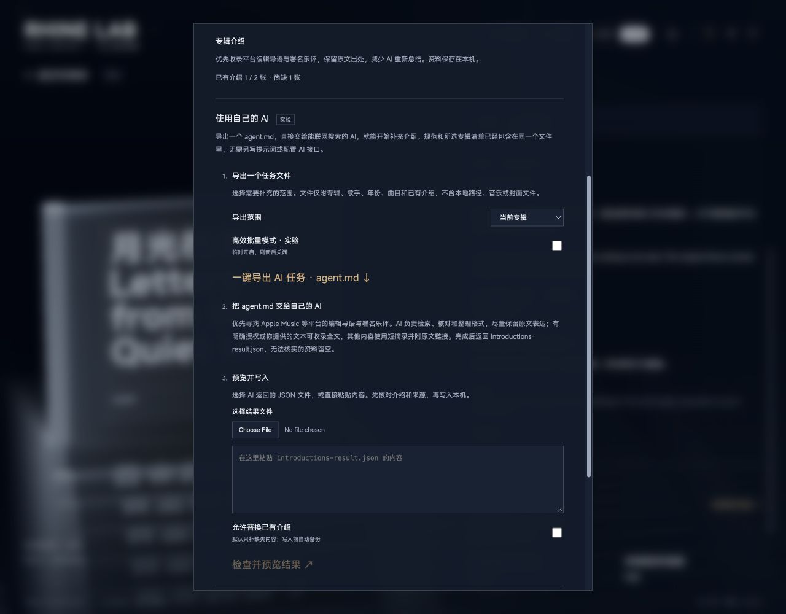

# V0.5.0 · 发布回归与验证记录

发布复核日期：2026-10-13。用户已明确授权整理文档并发布 GitHub。比较基线为当前本地 V0.4.1；本轮只修改 V0.5.0 的发布文档、两项依赖版本及打包工具，旧版本目录完整保留，未读取私人曲库。

## 本次发布回归

| 检查 | 结果与范围 |
| --- | --- |
| 锁文件安装 | `npm ci` 通过，依赖版本来自随包锁文件。 |
| 生产构建 | `npm run build` 通过，构建标识 `0efd5d9ae3b569db`；73 个离线预缓存文件、28.7 MiB。保留既有大于 500 kB 分块提示。 |
| 完整自动回归 | `npm run check:v050` 通过，覆盖音乐库、播放、真实列、总览投影与网格、封面、启动、灯光、开场、交互、视口、内容、资料、介绍导入、设置、界面音效与分发。包含实际运行的逻辑断言和合成场景，不等同于所有视觉逐帧验收。 |
| 界面音效基线 | 完整回归未设置可选旧版文件，随后指定当前本地 V0.4.1 的 `src/audio.ts` 重跑 `check:interface-audio`，5 项全部通过；非按键声音图谱、包络和取消清理与基线一致。 |
| 浏览器离线 PCM | `check:audio:browser-render` 通过，Chrome 154.0.8037.99 的 6 场景覆盖连续正弦、双向及非整帧采样率转换、取消下一首、跳转后接续；全波形、接缝和结束残留误差均为 0。只运行 OfflineAudioContext，不向设备发声。 |
| CoreAudio | 实际设备检查全程零音量，播放、暂停、跳转、设备选择和混采样率无缝接续通过；不据此推断全部外接设备兼容。 |
| 分发 | `check:distribution` 的 11 项检查（含真实打包回归）及实际清单检查通过：308 个源码文件、80 个构建文件。 |
| 依赖审计 | 更新后 `npm audit` 为 0 项漏洞；只表示检查当时登记的依赖公告结果。 |
| 文档 | DESIGN、当前 CHANGELOG、README、RELEASE 和 DISTRIBUTION 的本地链接均存在；参数与当前源码交叉核对。 |

依赖更新后的完整回归中的 Node 测试报告累计 375 项，373 通过、2 项条件跳过；其中可选音效基线已按上表补测通过。**最终未覆盖项为真实 APE 官方样本：本机未提供，明确跳过；没有下载或读取私人音频代替。** 其他独立断言脚本均通过。随后实际打包暴露中文文件名编码问题，修复后定向重跑分发回归，新增真实打包用例并达到 11 项全通过。

实测环境为 macOS 27.0.1 arm64、Node.js 26.3.0、npm 11.16.0、Vite 7.3.6、FFmpeg 8.0.1、Swift 6.4。最低支持要求仍为 Node.js 22.12.0；本轮没有另跑所有 Node 版本矩阵。

## 发布前依赖修复

安装审计发现 `music-metadata` 11.15.0 和构建依赖 `source-map-js` 1.2.1 的已登记问题，分别最小更新至 **11.16.0**、**1.2.2**。仅这两个包升级，无依赖树增删；music-metadata 的 MIT 与 source-map-js 的 BSD-3-Clause 声明不变，随包 music-metadata 许可仍与新版一致。最终构建与整套回归均在更新后的锁文件上执行。

参考：[music-metadata 安全公告](https://github.com/Borewit/music-metadata/security/advisories/GHSA-5gfj-9q3v-qfp3)、[source-map-js 安全公告](https://github.com/advisories/GHSA-68fv-2mgg-jv7q)。

## 源码附件的验收方式

首次实际打包被清单核对阻断，未生成发布成品。根因为 macOS 的旧 `zip` 工具未给中文 UTF-8 文件名写入编码标志。现改用系统 bsdtar 创建 ZIP，设置有效 UTF-8 环境、排除主机扩展元数据并归零 UID/GID，保留 CRC 检查，新增实际解压后的完整集合、逐文件 SHA-256 与执行权限比较。真实合成回归覆盖 C locale、中文文件名和输出路径、ZIP UTF-8 标志、unzip／bsdtar 两种解压，以及拒绝覆盖已有 ZIP 或校验文件。

使用 `scripts/check-distribution.mjs --zip` 从显式清单生成源码包及 SHA-256。附件发布前须完成 ZIP 清单与 CRC 检查、解压文件与 V0.5.0 源文件逐项字节／权限比对、解压目录锁文件安装与构建、本机空库服务冒烟，并确认 Git 提交的文件集合与源码包一致。GitHub Release 同时提供 `SHA256SUMS.txt`；附件最终结果以 Release 说明为准。

## 视觉检查与使用边界

本次发布整理未改视觉源码，沿用下方已记录的隔离合成库浏览器检查，没有重复用户明确要求停止的遮罩测试。以下各节是**发布前按具体修订进行的过程记录**，其中“未发布”“前轮”等只描述当时状态；撤回的方案和失败验收不是当前设计，现行约束以 DESIGN.md 和本次 CHANGELOG 为准。

本轮不调用外部 AI 或资料平台，不据此保证真实网页内容、介绍质量或所有库规模；无缝播放资源限制、共享输出以及不支持 Native DSD／DoP 的边界保留。第三方素材权利按 NOTICE 及各自许可处理。

## 中央英文标语替换 Logo · 发布前视觉记录

按用户后续决定，移除中央图形 Logo，仅显示原英文标语「ONE ALBUM AT A TIME」。保留本轮已经确定的淡入／停留／淡出和三维衔接时序；英文使用 14–22px 响应式字号与 .18em 字距，始终单行居中，底部 10px 跳过入口不变。

`check-music-boot-timing.mjs` 已同步并通过：唯一英文文本、无 SVG／旧轨道／中文标语，以及原时序、20／30／60／120fps、仅三维重播、跳过、打断、焦点恢复和减少动态效果均保留覆盖。

隔离零音量浏览器检查晨雾 1280×720 完整播放：英文中心 (640,360)，无 SVG，按 slogan→array→select 顺序在 7 秒交接主界面，期间页眉隐藏。月影 320×568 的英文为 14px、宽约 203px，中心 (160,284)，文字清晰且不溢出；点击跳过正常。临时视口和主题已恢复，控制台无页面错误，截图留在候选外。构建 **`0efd5d9ae3b569db`** 和分发检查通过，308 个源码文件、80 个构建文件；既有共享 JS 体积提示仍在。未改三维编排、音频或遮罩，未读取私人曲库、未发布。

## 中央标志与三维开场 · 前轮构建

音乐开场改为正中央完整 Rhine Lab 标志淡入淡出，随后接原有 5.2 秒三维专辑列动画。标志 600ms 淡入、500ms 停留、620ms 淡出，1.72 秒揭示场景、1.8 秒开始三维编排，全片 7 秒。移除描边、轨道、标语以及开场期间的固定页眉、导航和状态；结束时页眉、缩略图入口及调试面板随控件淡入。底部居中「跳过进场」为 10px 透明小字，点击区高 44px；焦点初始落在开场容器，Tab 可达跳过。月影标志文字显式沿用当前主题颜色，避免 SVG 默认黑字。

- `check-music-boot-timing.mjs` 通过，实际执行生产控制器，覆盖 20／30／60／120fps、完整与仅三维重播的原时钟对齐、全片页眉隐藏及恢复、冷启动／后台恢复、交接中重播、销毁、点击／Enter／Escape 跳过、焦点与减少动态效果。
- `check-music-intro-motion.mjs` 通过，原列间时差、轴向镜头和常态缓动连续交接不变。启动与渲染准备检查均通过，包含隐藏页恢复、初始化与销毁；GPU 准备使用模拟检查，实际画面由浏览器另行验证。
- 隔离合成库、零音量浏览器检查晨雾与月影、1280×720 与 390×844：标志中心分别为 (640,360)／(195,422)，跳过文字为 10px、无底色无边框、44px 点击区。晨雾横屏与月影竖屏完整播放分别记录 418／413 个有效时序样本，期间页眉持续隐藏，仅出现 logo→array→select，7 秒后正常淡入主界面并聚焦打开专辑。首次进入、点击／Tab＋Escape／Enter 跳过、仅三维重播及减少动态效果实际操作均正常，控制台无页面错误。临时视口已恢复；截图和时序记录留在候选外。

构建 **`463680db1bdd196c`** 与分发检查通过，308 个源码文件、80 个构建文件；既有共享 JS 体积提示仍在。仅验证本轮开场，未重复音频全套或已确认遮罩检查，未读取私人曲库、未发布。

## 晨雾增益默认 11 倍 · 前轮构建

晨雾 `dayGain` 的初始值和重置值改为 11，滑杆及参数限幅范围改为 0–20，步长仍为 0.1。已有合法自定义值和 URL 优先规则保留，其他光源、主题及遮罩未改。

`check-music-row-lighting.mjs` 通过，覆盖默认 11、旧值 6 保留、11／20 可用、越界限幅、非有限值回退，以及实际灯光控制器与着色器在主题过渡、入场、切列和运行中调节时的一致性。月影及 dusk 的增益仍为 1。隔离零音量合成库实际浏览器检查重置到 11、Home 到 0、End 到 20、方向键步进到 19.9；移除 URL 中的 dayGain 后重新载入，仍恢复本机保存的 11。滑杆 DOM 确认为 min=0、max=20、step=.1，无页面 JS 错误，截图留在候选目录外。

构建 **`a3f8573489f5276a`** 和分发检查通过，308 个源码文件、80 个构建文件；既有共享 JS 体积提示仍在。仅验证此次参数调整，未重复音频或遮罩检查，未发布。

## 文件与封面说明 · 前轮构建

将音乐库设置中的“文件与封面如何显示”折叠项改为常驻说明，标题为“文件与封面说明”，保留原两段规则和空曲库的演示入口。说明与统计区之间留白 22px，与下方分隔线之间留白 22px，段间 8px。实际浏览器核对晨雾横屏和月影 390×844 窄屏，说明不再是折叠控件，间距正常、无横向溢出。构建 **`60f0961fbbafe2e2`**、`check:settings` 和分发检查通过；仅检查本次说明排版，使用隔离合成库，未读取私人曲库或发布。

## 设置切页文字重叠修正 · 前轮构建

用户指出上一轮双页交叉淡化期间文字重叠。现改用歌曲详情 01／02 相同的 `ContentTransition(360)`：先同步切换两页的 hidden／inert／ARIA 状态，再仅对共同内容容器淡入，任意时刻只有选中页参与显示。快速切换沿当前容器透明度续接，重复点击当前页不重启动画，减少动态效果取消当前淡入并直接显示。标题与页签固定，两页 DOM、输入和滚动继续保留；移除原重叠网格与双页位移动画。

隔离零音量合成库实际浏览器验证晨雾横屏 1280×720、月影竖屏 390×844：淡入尚未完成时旧页的 display 已为 none、布局高度为 0；连续八次往返均只有一页可见，面板高度固定。未保存文件夹输入、展开状态和 647.5px 滚动位置保留。另实测方向键、减少动态、切页期间关闭及重开，无页面 JS 错误；视口已恢复，截图保存在候选外。

`check:settings` 通过，执行真实 ContentTransition／SurfaceTransition 与全局速度订阅，按 0／1／16／48／96／160／240／320／359／360ms 采样检查单页可见，并核对详情 01／02 的生产时长和缓动；快速切换透明度续接、重复点击、实时倍率、减少动态、关闭重开及既有草稿／异步编辑回归通过。

构建 **`7c1ba1fcacf7bc65`** 与分发检查通过，308 个源码文件、80 个构建文件；既有共享 JS 体积提示仍在。仅验证本次设置动效范围，未调整或重新测试已确认遮罩，未读取私人曲库、未发布。

## 设置整理与页签动效 · 前轮构建

主屏“音乐库”现在打开搜索与浏览，文件夹、扫描、排列、介绍、制作信息及分类配置集中到“设置 → 音乐库设置”；主题、画质、动效、声音及调试位于“画面与声音”。两页保持挂载、独立滚动，切页不重建输入或导入预览。页签复用现有 SurfaceTransition，以 240ms 入场、160ms 退场轻移并交叉淡化，继承全局速度，支持快速反转及减少动态效果。

- 构建 **`eda6484f7e4aecb0`** 通过；既有共享 JS 体积提示仍在。分发合成检查 10 项通过，源码 308 个文件、构建 80 个文件，新增设置测试与 CSS 已纳入显式清单。未打包或发布。
- `check:settings` 执行生产渲染器、事件分支及真实 SurfaceTransition，覆盖快速反转、退场完成后隐藏、inert／ARIA、独立滚动、草稿和预览保留、关闭重开、减少动态效果。分类规则使用可控延迟请求验证双击合并、等待期间切页及旧请求晚到。
- `check:startup`、歌曲衔接 UI、列浏览位置、画质检查及 23 项介绍交换／批量检查通过。本次未重复整套音频设备与场景回归。
- 实际浏览器使用隔离内存 API、6 张虚构专辑／18 首无音频曲目，零音量且关闭音效与氛围音乐；没有读取私人曲库或访问第三方资料平台。搜索可定位歌曲且不开始播放；设置输入、AI 预览、分类草稿及滚动位置在切页后保留。预览界面使用合成 API 响应，后端数据校验与备份由上述自动检查覆盖。
- 检查晨雾／月影、1280×720、390×844 和 320×568，以及正常窗口大小。窄屏两页无横向溢出；移除旧导航按钮后同步修正两档竖屏网格，音乐库、主题、设置及播放按钮各自可点击。实际字号为标题 22px、页签／分组 14px、控件 13px、正文及次要操作 12px、提示 11px。
- 实测方向键／Home／End 切页、减少动态效果、展开精细画质及高级调试、关闭返回。修正焦点循环不进入折叠内容，Shift+Tab 从关闭按钮到“关于”，Tab 再返回关闭按钮。浏览器未记录页面 JS 错误；临时视口已恢复，截图留在候选目录外。

本轮未修改或重新测试用户已确认的遮罩。原版入口的画质标记保持原分支；本次原版验证为自动检查，未另行浏览器验收。

## 主题名称「晨雾／月影」· 前轮构建

按用户确认将公开主题名称由「暖昼／深夜」改为「晨雾／月影」，同步顶部切换、设置样卡、页脚状态、光效增益及无障碍名称。内部 `day`／`night` 和本机偏好不迁移，配色、材质、灯光、遮罩与动画代码不变。

构建 **`d2d4195c9d764593`** 通过。既有启动、歌曲衔接界面和列位置检查通过；启动检查补齐先前歌手网格加入后遗漏的隔离 `overviewUI.setArtists` 依赖桩，未改动生产启动逻辑。隔离零音量演示页验证两种主题切换、顶部／设置／页脚及「晨雾强度增益」文案，另核对430×932设置名称；临时视口已恢复。截图保留在候选目录外。仅核对本次名称变更，未重新测试或调整已确认遮罩，未读取私人曲库、未发布。

## 歌手网格适用范围开关 · 前轮构建

设置「动效与显示」新增「所有比例使用歌手网格」。偏好 `artistGridAllRatios` 默认false，严格布尔归一化并保存至既有本机偏好。开启时所有有效视口使用现有歌手网格，主题不参与分支；关闭时使用场景共用的 `isPortraitViewport`（宽高比<1.05）。沿用原网格磨砂、有限顺序入退场、目录、选择及键盘逻辑，不重载页面或改变播放。height≤380时网格上边距按品牌位置收紧，避免超宽矮窗口没有完整行。已确认的详情遮罩未作修改。

- 隔离合成演示库实际设置检查：默认关闭，开启后1440×900显示13位歌手且没有投影名牌；刷新重新打开设置仍为开启。点击Eminem后正确返回对应近景。深夜横屏仍为grid，保留4px磨砂。关闭后横屏恢复投影，网格及磨砂隐藏。
- 浏览器629×600与场景同为portrait+grid，630×600同步转compact+projected，430×932关闭开关时仍显示完整网格。1920×300开启后网格可视高度82px，最后一项68px完整显示，返回按钮与网格相隔20px；End可达最后一位歌手，Enter可选择返回。
- `check:overview`新增无效尺寸、统一断点、强制横屏、主题／速度／减少动态组合、开关打断与快速重开、旧投影和磨砂清理、目录节点／滚动／选中保留及camera wait检查。`npm run build`、`check:interaction`、`check:viewport`、`check:distribution`通过。构建 **`750cae3b24819bb0`**，306个源码文件、80个构建文件。

仅验证本次网格开关相关范围，未重新调整或专门测试已确认遮罩，未重复音频全套回归。浏览器使用零音量与隔离合成样本，截图留在候选外；未读取私人曲库、未发布。

## 横屏暖昼详情外壳清透 · 用户已确认保存

用户允许部分正文背景半透明，并优先要求专辑完整外壳投影清透。横屏暖昼常驻侧向渐变改为50%／66%／82%，详情阅读底色改为50%→70%完全不透明，上下清透区扩大为2%–92%。打开准备及旋转返回阶段保留下沿空间，归位后恢复浏览的2%–82%。原70ms领先、650ms渐变、360ms入场、240ms退场未改；竖屏和深夜原规则保留。

收到“可以保存，不用再测试”前已完成的验证：构建 **`25dc1045546a1eea`**、交互回归与viewport检查通过；隔离合成库实际浏览器1600×900默认详情与拖转检查通过，拖转后下沿88.65%仍在92%清透区内。记录的182个进入／详情帧、1200个拖转／返回历史帧按实际computed stops核对，无外壳投影叠加遮罩；本次入场实测常驻渐变领先文字约69.5ms。原竖屏24%–73%上下渐变及50%高度阅读底色仍在。合成演示中正文可读，未读取私人曲库。

生产几何与相机采样补查正常横屏范围、进入返回、拖转及同列切换，完整抬起外壳处于清透区；未把仍沉在阵列中或已离屏的实体部分计作完整抬起。此次为局部CSS调整，未重复音频全套检查。用户已确认当前遮罩并明确停止测试，收到指示后未再运行检查或继续调整；源码与设计约定已保存，未发布。

## 横屏清透区与延后进入、竖屏回滚 · 前轮记录

横屏暖昼默认近景的两层侧向渐变改为屏宽 50% 才开始，纵向透明区为高度 2%–82%；右侧后续 alpha 与不透明阅读终点保留。使用实际 GLB 完整八角和生产相机／选中模型变换采样，包含常态波浪与指针视差：3798×1644、1440×900、1024×768、780×480、2560×1080 的归位盒体均在清透区内；普通相邻专辑浏览的抬升阶段最大右沿 48.66%、底沿 81.05%。这里的零遮罩仅指 CSS 覆盖，不代表移除材质、雾或景深，也不保证远距离切列经过右阅读区的整段轨迹。用户明确撤回本轮竖屏试调，已完整移除新增竖屏覆盖规则，恢复原纵向 24%–73% 区间、原阅读渐变及 callout 底色。

横屏暖昼详情的常驻渐变改为相机就绪后才启动原 650ms 过渡，文字窗随后 70ms 开始原 360ms 入场；其不透明底色仍与文字 surface 同程，240ms 退场及镜头速度不变。等待使用可取消且跟随速度的动画时钟；隐藏时不解密文字、不获取焦点，关闭、重播、重复打开、销毁与减少动态效果不会留下晚到的窗口。竖屏、深夜及 dusk 不增加等待。

- 隔离合成库实际浏览器 1440×900 逐帧记录：点击打开后至约 2435ms 相机就绪，常驻遮罩始终保持近景节点；随后启动渐变，2506ms 文字窗开始，实测提前量 71ms；约 2885ms 窗口完成，符合 360ms 加采样间隔。暖昼开关、打开中立即 Esc 返回均通过。
- 430×932 实际 computed style 确认恢复原上下渐变与原 callout alpha .75，详情同一帧 ready／visible，未增加 70ms。检查横屏深夜仍为 32%／58%／78%、24%–73%，暖昼层 opacity=0，阅读起点仍为 42%。截图和帧记录在候选目录外；零音量、阻断音乐 API，未读取私人曲库。
- `npm run build`、`check:interaction`、`check:viewport`、`check:overview`、`check:distribution` 均通过。presentation 共 31 项，新增测试覆盖完整 70→360→240 时序、lead 中 Esc、重播／销毁／重开、动态变速、finish 减少动态，以及直接执行生产 showMenu 的 18 种主题／布局／减少动态组合。
- 构建 **`a82907eea1445801`**，306 个源码文件、80 个构建文件。此次局部界面调整未重复音频全套回归；未发布。

## 暖昼增益范围与默认遮罩核对 · 前轮记录

按用户要求将暖昼 `dayGain` 范围改为 0–15，默认 6，步长仍为 0.1；缺失字段和首次启用使用 6，已保存的合法用户选择保留。实际浏览器验证 End 调到 15、原强度 1.3 时有效值 19.5，重置回 6；本轮不改变其他光源、材质、开场或遮罩。

针对用户 19:09 截图的横屏默认近景，独立核对源码和实际 computed style：常驻侧向渐变为屏宽 32%／58%／78%／100% 对应 alpha 0／.28／.78／.84；阅读遮罩为 42%／66%／96% 对应 0／.75／1；纵向在顶边 .40 → 高度24% 的 0、高度73% 的 0 → 底边 .72。父级稳态 opacity 均为 1。中线合成 alpha 在屏宽 50%／58%／66%／69%／78%／96% 处分别为 39.5385%／64%／87%／89.9875%／96.7%／100%。制作了以用户截图为底图的红色分层诊断 HTML 与 PNG；为保留原图可读性，红色显示浓度按实际 alpha 的 55% 映射，数字标注为实际值。图像、截图和诊断页面保存在候选目录外，不分发。

`npm run check:lighting`、`npm run build`、`npm run check:distribution` 通过，浏览器无页面错误；测试覆盖 0／1／6／15、合法旧值保留和超界限幅。构建 **`499b244a4df5b8a9`**，306 个源码文件、80 个构建文件。本轮为局部参数调整，未重复音频回归，未读取私人曲库，未发布。

## 暖昼增益调节与仅三维重播 · 前轮记录

光效调试面板顶部新增「暖昼强度增益」：0–6 倍、步长 0.1、默认 3，1 为原强度，实时生效并保存在本机；URL 参数为 `dayGain`。暖昼移动灯带实际强度为原高级强度乘以增益，深夜／dusk 沿用原强度，主题过渡连续混合。环境光、主灯、散射、材质、整体曝光及原宽度／偏移／补光／运动参数不变。

同处新增「仅重播三维入场 ↗」，立即从原开场的三维段开始，持续隐藏二维纸层和文字，保留原 5.2 秒镜头、异步列波浪和光带编排；沿用原开场时钟、跳过、减少动态效果和常态缓动交接。设置中的完整开场重播入口保持原义。

- 实际浏览器在隔离合成演示库验证调节、键盘 0.1 步进、刷新及移除 URL 参数后恢复本机值、昼夜切换、三维重播完成及跳过、详情页直接重播。暖昼原强度 1.3／增益 4.2 时实际值 5.46，深夜恢复 1.3；环境强度与印刷曝光分别保持 .30／.94。检查桌面和 430×932 竖屏的控件可达性，交付前恢复默认增益 3。
- 点击重播后首段实测 `phase=array`、二维树 hidden、灯带处于 opening；结束后回到正常浏览并保留增益。截图及临时帧观测器保存在候选目录外，不随分发。测试零音量、阻断私人音乐 API；浏览器无页面错误。
- `npm run build`、`npm run check:lighting`、`npm run check:interaction`、`npm run check:distribution` 全部通过。灯光回归覆盖 0／1／3／6 倍、四种模式、三种主题、旧偏好迁移、范围限制和主题过渡中调节不重启轨迹；开场回归在 20／30／60／120 Hz 对照原三维段，覆盖完整／仅三维往返、中断、跳过及减少动态效果。构建 **`72dd6ffb3f6f30f0`**，306 个源码文件、80 个构建文件。未重复音频全套回归，未发布。

## 降低全屏磨砂强度 · 前轮记录

用户指出背景阵列被过重磨砂抹成整片底色。本轮全屏磨砂改为 4px 模糊、5% 主题染色、.95 饱和度（原 24px／12%／.8），保留阵列轮廓；磁贴 64% 底色和文字完整亮度保持。动画滤镜终点与 CSS 标准／WebKit 静态值同步，入场完成时不切换成另一套强度。原页面景深及边缘渐变未改动。

实际浏览器使用隔离演示库，检查暖昼竖屏、深夜、800×800 方形及入退场，确认背景阵列可辨、标签清晰、网格背后没有局部底板。computed style 验证 blur(4px) saturate(.95)、染色 alpha=.05、磁贴 opacity=1；构建和现有总览回归通过，分发检查通过。构建 **`f2664675ccbf3241`**，306 个源码文件、80 个构建文件。未重复音频回归，截图在候选目录外，未读取私人曲库、未发布。

## 全屏磨砂与歌手磁贴顺序入场 · 前轮记录

用户明确要求删除歌手网格背后的局部底板，在整个专辑阵列上叠加全界面磨砂，再依次显示独立标签。本轮移除网格的背景、外边框和阴影，磨砂改为总览内独立的全屏同级层；网格仅承担布局和滚动，标题、页眉及操作保持清晰。

- 磨砂与网格同步使用 460ms／240ms 显隐，模糊从 0 连续变为 24px；磁贴在磨砂开始 80ms 后按阅读顺序轻微上浮淡入，每项 360ms，首末时差最多 196ms，整段不超过 636ms。全部动画跟随全局速度。
- 仅当前滚动视口的标签参与顺序编排，屏外歌手保持可达；滚动和聚焦结束相应延迟。入场中关闭保留当时的透明度，再完成退场；快速重开从当前值继续。关闭时的惯性滚动不清掉淡出保持状态，曲库刷新延至退完或重开后再应用。横屏、减少动态效果和销毁均清理磨砂层。

验证结果：

- 实际浏览器 430×932 暖昼逐帧记录：点击后约 117ms 磨砂开始，13 项分别于 198、217、232、249、265、282、298、315、336、352、366、382、398ms 开始显现，765ms 全部完整可见且动画数为 0。首末顺序与设定一致；采样约 60Hz，实际帧完成点包含采样间隔。
- 600×600 检查磨砂覆盖精确 0,0→600,600，网格背景 rgba(0,0,0,0)、边框 0px、阴影 none；601×600 切回投影名牌，网格及磨砂同步隐藏。430×932 暖昼与 320×568 深夜截图确认无局部底板。
- 120 位合成歌手、0.25 倍慢速入场中关闭并立即重开：两层透明度均从 .881343 连续续接，旧关闭没有隐藏重开层；最终动画归零。End 可达第 120 项，Enter 正确选择并返回近景。实际设置面板切换深夜和减少动态效果；减少动态下立即显隐，无磨砂残留。测试仅使用隔离合成曲库、零音量，音乐 API 被阻断。
- 生产控制器与模拟 DOM／WAAPI 回归增强覆盖：200 歌手与可见项有界顺序、延迟中途变速、40／120／300／700ms 中断重开、关闭中滚动／曲库轮询、focus／scroll、finish／dispose、方形边界及退出中旋转、三种排序选择和旧回调。模拟时钟不替代上述真实浏览器检查。
- `npm run build`、`npm run check:overview`、`npm run check:interaction`、`npm run check:viewport`、`npm run check:distribution` 均退出 0。构建 **`1f425c4bc85b9722`**，306 个源码文件、80 个构建文件；既有共享 JS 大块提示保留。本轮为局部界面动效修改，未重复音频全套回归。

截图与逐帧记录留在候选目录外。未读取私人曲库，未发布。

## 方形与竖屏完整歌手面板 · 前轮记录

用户截图指出竖屏投影名牌仍然缺项，明确改为从 1:1 起使用完整歌手面板。此前“窄屏选中入口可达”的检查只证明单个入口存在，不能证明用户能看到完整歌手目录；本次按新设计替换该范围的交互。

- 舞台宽度 ≤ 高度时显示独立网格，使用曲库全部专辑按歌手归一化归组，保留完整歌手及专辑计数，与场景投影、碰撞、折叠和当前排序无关。宽高比 >1 保留现有投影名牌，精确断点不复用相机 1.05 阈值。
- 窄屏两列、较宽方形三／四列，名字自然换行，内容过多时面板独立滚动。原投影名牌和列导航在此布局隐藏并清理；方向键、Home／End 操作网格，滚轮不再驱动后台专辑。歌手文本用 textContent，不解析成 HTML。
- 点击歌手返回近景，不打开详情或播放。按歌手排序复用列记忆；其他排序定位属于该歌手的专辑，当前／待执行选择属于同一歌手时保留。网格与总览共用 460ms／240ms 动画和全局倍率，镜头等待面板退完；减少动态效果立即完成。快速重开和旋转取消过期关闭，未变化的曲库轮询不重排节点或重置焦点／滚动。

验证结果：

- 新增纯目录与实际 UI／SurfaceTransition 回归：200 位歌手零投影仍全部存在、排序无关、规范化同名／空名／特殊字符、长名字、完整键盘路径、节点／滚动／焦点稳定、相同曲库零节点重排；0.25／1／3 倍速度完整入退场、中途变速、快速重开、减少动态效果、600×600／601×600 精确切换、退出中旋转、hasLabels 等待最后一帧。另提取实际应用选歌手／选列／列记忆函数，验证三种排序、待处理选择、重建期间意图、无效与关闭后的点击。
- 实际浏览器用隔离 13 位歌手／69 张专辑、每张 8 首合成曲目，零音量且阻断音乐 API。600×600 显示全部 13 位歌手，601×600 恢复投影且面板隐藏；320×568 用 End 到最后一项再 Enter，准确返回第 13 位歌手近景；430×932 完整显示 13 项且无横向溢出。选择 Eminem 后立即 V 重开保留正确选中项，无旧标签叠加。
- 另用 120 位歌手验证深夜＋流派排序＋减少动态效果：全部 120 项存在，原投影节点为 0，原生滚动后选中歌手不变，End 到第 120 项可选择并正确返回近景。专辑排序＋3 倍速度仍显示全部 13 位歌手，选择 55 张专辑的歌手能正确定位。最终恢复暖昼、歌手排序、1 倍速度、正常动效及默认窗口；浏览器 error 日志为空。
- `npm run build`、`npm run check:overview`、`npm run check:interaction`、`npm run check:viewport`、`npm run check:distribution` 均退出 0。新增四个生产／回归文件已纳入分发清单；构建 **`d9672b336abe53b2`**，306 个源码文件、80 个构建文件。既有共享 JS 大块提示保留；本次未重复音频全套回归。

截图与浏览器数据留在候选外，不进入发行内容。未读取私人曲库、未发布。

## 暖昼详情底色与内容同步 · 前轮记录

用户指出不透明背景比歌名／曲目入场过早。隔离浏览器实测旧版本：点击后约 657ms 底色已完全出现，详情内容至 2457ms 才开始，存在约 1.8 秒提前量。根因为详情模式在镜头开始前即触发背景的独立 650ms 过渡，而文字等待相机完成后再进行 360ms 入场。

生产改动仅在 `src/music-theme.css`：移除模式驱动的阅读透明度变量，把横屏不透明底色移至详情 surface 的 `::before`，与文字共用实际 360ms 入场／240ms 退场及缓动、减少动态效果、全局速度和中断续接。底色保持固定 48%→60% 渐变，正文单独横移；稳定阅读时仍为完全不透明。昼夜仍通过原主题混合连续过渡；深夜与 legacy dusk 原渐变、竖屏原底色及常驻双渐变均保留。

验证：

- 实际浏览器使用隔离 13 列／69 张合成专辑、每张 8 首合成曲目，零音量并阻断音乐 API。1280×720 暖昼打开／返回逐帧记录显示，镜头阶段详情与底色保持隐藏，约 2460ms 同帧开始入场，2826ms 完成（配置 360ms，采样间隔约 16.7ms）。退出共用 240ms 动画，关闭后不残留不透明层。
- 0.25× 慢速实测在 9761ms 同步入场，11210ms 完成，约 1.45 秒，符合 360ms ÷ 0.25；退出约 0.99 秒，配置为 240ms ÷ 0.25。未发现独立背景提前量。
- 430×932 竖屏目视与帧记录通过，暖昼底色仍在正文顶部达到不透明。详情内暖昼→深夜→暖昼检查通过，新增层随主题从 alpha 1 连续到 0 再返回，深夜保持原渐变。减少动态效果下开关同步完成且无遗留动画。最终恢复正常动效、1×速度及默认窗口；浏览器 error 日志为空。
- `npm run build`、`npm run check:interaction`、`npm run check:viewport`、`npm run check:distribution` 均退出 0；构建 **`cd584aa06b895cea`**，分发 302 个源码文件／80 个构建文件。现有交互回归覆盖详情就绪门槛、换片、开关中断、旧回调、速度中途切换和减少动态效果。本次为 CSS 时序修正，未重复音频全套回归；既有共享 JS 大块提示保留。

逐帧记录和截图保留在候选目录外。未读取私人曲库、未发布。

## 名牌完整退场、尺寸与总览齐平 · 前轮记录

用户指出名牌有缓进入场，但挤压退出时动画被截断，并补充总览不应弹出选中专辑、标签应适当缩小。旧检查只确认“最终删除”与不碰撞，没有确认正常移动中淡出是否完整。基线重现：60px／编排秒接近边界、邻卡时，原 4／8px 余量让 240ms 退场分别在约 67／133ms 被硬清理；新候选还能抢占正在退场的旧标签。

修正后的行为：

- 当前物理投影直接定位，按 200／500ms 未来投影提前退出；退场卡保留占位直到动画完结，新卡不能抢位。退出一旦开始不再因减速或反向重开，也不会被总览整体关闭重置。
- 正常空间充足的退场保留 240ms。近边从静止加速时，仅连续加快同一 WAAPI 的剩余段，在接触前完成；不跳 currentTime 或 alpha。折叠与 2／3 列循环副本替换同样预留退场时间。突发缩窗、缺失投影或身份跳变仍保留安全清理。
- 浏览器高速返回暴露了额外边界：收镜头加速会挤掉仍在淡出的顶端标签。返回流程现在先等标签实际完成，再收镜头；减少动态效果立即完成，中途重新进入会取消旧关闭请求。
- 标签桌面从 160×57 收至 144×46，窄屏从 116×53 收至 104×42；箭头 36→32、引线 22→18，12／11px 主字号及 9px 辅助字保留。新候选连续安全 120ms 编排时间后才挂载，短暂空隙不触发反复入场。选中入口、箭头和完整碰撞边界不放宽。
- 总览选中专辑及正在归位的旧副本使用同一个 `1 - overviewProgress` 可见弹出量，保持阵列高度与倾斜；回到默认视角时随镜头恢复，沿用全局速度。默认预览、详情、开场不改动其原弹簧。

验证：

- 生产 TypeScript + 模拟 DOM／WAAPI 回归覆盖 30／60／120Hz × .25／1／3 倍速度：完整 240ms 恒速退出、14px 近边加速／反向、同一动画连续加速、全局速度中途改变、退出后新候选等待、120ms 短安全窗口抑制、整体关闭不重启已加速退出、减弱动态、稳态 alpha=1、320px 选中入口。模拟插值不冒充真实浏览器画面。补充提取真实 app `setOverview/updateOverview` 的生命周期检查，确认最后一个标签退出后才收镜、隐藏 surface 不丢请求、重新进入取消旧返回、减弱动态立即完成；该检查落盘后单独重跑 `check:overview` 退出 0。
- Three.js 实际矩阵验证选中与归位副本在总览中与阵列实例重合；返回进度与现有镜头一致，无独立弹跳计时。小曲库 2／3 列双向跨副本阈值、停稳、回转及 2／3／8／13 列坐标重定位均检查。
- 实际浏览器使用隔离 13 列／69 张合成演示库、零音量，阻断音乐 API。覆盖 1891×819 暖昼连续切列、反向、点击名牌及展开箭头返回；430×932 深夜；780×480 真实专辑列＋减少动态效果；320×568 选中入口及 .25 倍慢速往返。最终返回顺序修正后另完整复测 3 倍高速连按、反向、点击 Eminem 后立即返回及 .25 倍窄屏单步／返回：记录 14 次节点退场，硬截断 0，返回后名牌节点 0，浏览器 error 0。截图与逐帧退场记录在候选目录外保存。
- `npm run build` 与 `INTERFACE_AUDIO_BASELINE=../V0.4.1/src/audio.ts npm run check:v050` 退出 0；构建 **`e45f208b55208bef`**，分发检查 302 个源码文件、80 个构建文件。真实 APE 样本缺失仍明确跳过，既有共享 JS 大块提示保留。未读取私人曲库，未发布。

## 暖昼详情阅读区透底修复 · 前轮记录

用户要求详情页歌名后的遮罩与预览观感一致，完全挡住背景专辑。实际浏览器复现：预览的 `music-browse-veil` 退出后，横屏详情只有常驻半透明渐变，正文从 60% 屏宽开始，原遮罩在 48%／70%／最右的 alpha 仅 .28／.78／.84，因此曲目区明显透出专辑。

本轮生产变更仅在 `src/music-theme.css`：常驻暖昼遮罩增加阅读底色，从 48% 渐变至正文左沿 60% 的不透明 `#e8e5e1`，按详情模式跟随已有 650ms 过渡。底色不与详情文字共用淡入父层；沿用暖昼／深夜交叉透明度，深夜原渐变保持原样。暖昼竖屏改为在 50% 屏高正文起点完成底色，修复短窗口中固定 34px 渐变仍覆盖标题顶部的问题。

验证使用隔离演示专辑与四条合成曲目，零音量，不读取私人曲库。实际点击打开专辑、详情内暖昼→深夜→暖昼、横竖屏切换、竖屏滚动歌单、返回预览并重新打开；查看 1440×900 桌面、780×480 窄横屏和 320×568 短竖屏截图及实际 computed style。横屏不透明起点分别为 864px、468px，与正文左沿一致；竖屏在 284px 起不透明，与正文顶部一致。歌名后方不再透出专辑，预览恢复原遮罩，深夜仍使用原图层。

`npm run build` 与带本地 V0.4.1 音效基线的 `npm run check:v050` 均退出 0；当前构建 **`562654b13d2b7153`**，分发检查 302 个源码文件、80 个构建文件。真实 APE 样本缺失仍明确跳过。截图及观测记录保留在候选目录外。V0.4.1 未修改，未发布。

## 22:00 远端暗淡名牌 · 前轮记录

用户截图仍显示选中 Eminem 后远端 Kendrick Lamar 的暗淡标签。**撤回上一轮“标签已完成修复”的判断**：原几何检查可以证明没有额外推移或碰撞，但允许普通名牌永久半透明，旧测试甚至将 extent=.3 对应 alpha=.3 当成正确结果，因而没有覆盖这次缺陷。

本轮在实际浏览器用隔离 13 列／69 张合成演示库（各列计数 `[1,1,1,1,2,1,2,1,1,1,55,1,1]`、零音量、阻断音乐 API）操作：进入总览，点击下一列，再点击 Dr. Dre、Eminem 名牌。修复前已目视复现截图同型缺陷，停稳后的 Kendrick 名牌 card alpha=1，但 anchor alpha 持续为 **0.341202**。同一模型还会把边界带和碰撞带中的名牌停在 .5；它们始终被当作可保留、可点击的名牌，因此等待或 finish 动画没有用。

当前修复：

- 空间距离只决定显示资格；取消持续空间 alpha 和渐近增亮状态。远端尚未展开的列不挂名牌（extent 入场 >.995、保留 >.98）。
- 完整几何保持原样；边界额外净空入场 >8px、保留 >4px，邻卡净空入场 >10px、保留 >8px。保留完整箭头、细引线与标题／页眉／底部控件保护，不改变投影位置。
- 可见名牌有限淡入至 1；不再符合资格的名牌立即停止命中并有限淡出移除。实际越界／相交立即移除；本帧已移除的退场卡不再截断邻居淡出。普通速度为 460ms／240ms，随全局速度调整，减少动态效果立即完成。
- 检查期间发现额外净空 24／12 会隐藏 320px 宽窗口中原本安全的选中名牌，已调整为 8／4，并保留选中入口可达性断言；没有通过删掉测试规避问题。

验证结果：

- `npm run build`、`npm run check:overview`、带本地 V0.4.1 音效基线的 `npm run check:v050` 均退出 0。最终构建 **`3d3ef1fa9bc9874d`**；分发检查 302 个源码文件、80 个构建文件。真实 APE 样本仍未提供，对应检查明确跳过；现有共享 JS 大块提示仍在。
- 回归增加 3 种静态残影来源 × 30／60／120Hz × 减少动态效果开关 × .25／1／3 倍速度：停止输入 10 秒后逐个检查全部保留名牌必须为 alpha=1、没有持续动画或 closing 残留；半展开远端必须移除。新检查在修复前明确失败，修复后通过。
- 另检查退场期限、反向恢复、硬删除后重建、旧回调不得复活／删除新卡、同时退场卡的删除顺序，以及实际 `music-app` 名牌点击分支和选列函数；保留原直接投影、完整几何、物理身份、坐标重定位和窄屏可达性检查。
- **本轮真实浏览器操作**：1891×819 暖昼填充模式，连续点击 Dr. Dre → Eminem → fun. → Jason Mraz、快速前进 3 次再后退 3 次、展开箭头回近景；430×932 深夜点击 Kendrick；320×568 展开箭头并返回；780×480 深夜真实排列＋减少动态效果，点击 55 张长列并快速往返。共记录 12 个观察点、41 个保留名牌观测，全部 open 且 alpha=1；返回近景后名牌节点为 0，浏览器 error 日志为 0。已逐一目视桌面、竖屏、320px 和短横窗截图。

本轮浏览器结果属于实际点击与停稳观测；不同帧率／速度和逐帧不变量属于生产 TypeScript 与模拟 DOM 回归，二者不混称。未将上一轮 10,101 帧矩阵当作这轮新策略的复测；未接触私人曲库、未发布。当前截图、观测 JSON 与构建日志留在候选目录外的本地检查目录，不进入分发。

## 上一轮 V0.4.1 基线核对记录（残影验收已撤回）

用户 15:18:23 的第二段录屏确认上一轮仍存在下跳和撞边。**撤回下方旧 P0 段落的完成验收结论**；它仅保留为失败调查历史。旧检查未覆盖完整边界和引线，且 30px 单帧阈值漏掉连续小幅重排；13 列真实排列及 2／8 列填充也不能替代录屏的 13 列填充慢速操作。

本轮对照本地 V0.4.1 与当前 V0.5.0，排除依赖、构建、缓存、私人数据及系统元数据后，共分类核对 **39 个新增、69 个修改、239 个移除项**。原目录保留，179 个基线源码／资源／内容文件逐个 SHA-256 复核一致。文件移除大多是先前已授权的研究、宣传及旧验证材料清理；未恢复已终止实验。

| 差异范围 | 审查与处理 |
| --- | --- |
| 缩略图标签 | 移除动态缩放、夹边、纵向错行和运行中紧凑换排，恢复 0.4.1 的直接投影；固定响应式尺寸，展开／选中列优先。 |
| 边界与碰撞 | 卡片和预留箭头、1px 细引线分开测量。接近边缘前渐隐，标题只占自己的实际矩形，避免通过过度隐藏标签来“通过”检查。退场仍跟踪投影；只平滑透明度恢复，不平滑或推挤位置。 |
| 连续运行身份 | 保留小曲库物理拷贝滞回；物理身份使用含坐标原点的连续编号，长时间切列触发局部坐标重定位时不再重建同一可见标签。 |
| 开场／相机／模型／灯光 | 保留已记录接受的逐列统一时差开场、常态无停滞交接、取消跨列附加偏转、盒体 3.996／列距 4.746、暖昼恢复及稳定雾距／曝光／边条。对应场景、模型、镜头、灯光、实际交接检查重新运行。 |
| 主界面／详情／交互 | 保留等边留白、滚动槽补偿、单专辑导航修正、页签与歌曲定位节奏、名牌选列／箭头近景交互。重新检查主界面、详情、总览及主题／尺寸切换。 |
| 介绍与本地接口 | 保留预览、来源、修订冲突、默认不覆盖、备份及并发互斥。修复合法 4 MiB 结果被请求包装误拒绝：请求壳另留 1 KiB，结果上限不变；真实 loopback HTTP 回归通过。 |
| 封面与启动 | 保留已选 B 排印缺图方案；字体准备统一 400／600／700，最多等 2.5 秒，移除重复的无界等待。永久 pending、失败、迟到与销毁路径均检查。 |
| 播放与依赖 | 播放器、PCM／浏览器无缝和音频输出核心与 0.4.1 字节一致；依赖版本不变。右上衔接按钮继续调用既有机制；除已获准替换的 key 音外，其他界面音与 0.4.1 对照检查通过。 |
| 分发与原版 | 保留许可、来源、原版入口与当前依赖资源；先前获准移除项保持移除。源码／构建白名单重新检查，没有发布。 |

根因证据：旧算法两列投影的横向距离只改变 0.02px，即可把另一标签目标纵向推移 52.46px。冻结修复前模块后，以 13 列填充、计数 `[1,1,1,1,1,1,2,1,1,1,55,1,1]` 和普通按钮节奏复现：实际 DOM 矩形存在 2243 条大于 1px 的非投影位移记录，并出现细引线穿卡。不能把相机连续运动下的额外 18px 下移视为正常，也不能用旧 30px 阈值漏报。

V0.4.1 的同夹具浏览器对照没有动态错行，但原版的边缘／退场安全问题也没有照搬。第一版直接投影曾因把细引线当作整张宽矩形而隐藏正常邻列；该中间方案被视觉复核否决。最终保留正常对角相邻标签和每次停稳的选中入口，不能只以零重叠作为通过依据。

当时验证结果（不能作为当前残影修复验收）：

- `npm run build` 与带本地 V0.4.1 音效基线的 `npm run check:v050` 全部退出码 0；最终构建标识 **`5eb670d2e84a19ba`**。分发检查 302 个源码文件、80 个构建文件。唯一跳过项是未提供真实 APE 样本；不把该项算作真实 APE 验收。现有共享 JS 大块提示仍在，构建成功。
- 单元／实际场景检查新增：旧 0.02px 错行输入、正常六列间距不被过度隐藏、完整几何与标题局部障碍、边界前透明度归零、遮挡解除平滑增亮、退出／反转／焦点／失效回调及物理副本生命周期。坐标重定位执行真实 production 方法，覆盖 2／8／13 列、正负方向、累积原点和连续重定位；在内存换回旧返回值能确定失败，新值下身份和投影均连续。
- 实际 Chrome 共 **10,101 个实际 rAF 帧**，逐帧检查名牌实际矩形中心／底沿与原始投影（1px 阈值），加上视口、标题、控制区、进入箭头和 1px 引线；五组的额外位移、越界、碰撞、物理身份错配和页面 JS 异常均为 0。86 个停稳点的选中入口全部可点击；真实点击箭头回近景后保留所选列。

| 浏览器夹具 | 视口／DPR | 采样帧 |
| --- | --- | ---: |
| 13 列填充，录屏同类计数，静置 60 秒 | 1863×782／2 | 2474 |
| 2 列填充 | 1440×900／1 | 1866 |
| 8 列填充竖屏 | 430×932／2 | 1915 |
| 13 列真实排列短窗 | 780×480／1 | 1921 |
| 13 列真实排列，减少动态效果 | 1440×900／1 | 1925 |

这些路径包含慢速按钮、循环边界、快速正反向、双主题、反复开关、后台冻结恢复及展开后实际进入近景。13 列桌面停稳保留 6–7 个可见名称；竖屏／短窗按安全几何显示较少名称，选中列与导航入口仍可用。减少动态效果的 115 次节点重建中，109 次对应快速导航时投影确实越界／离开，6 次对应明确退出／重进；慢速、静置、主题及后台恢复没有反复重建。

静置实际采样 60.008 秒、1568 帧，帧间隔中位数 33.4ms、P95 50ms；部分时段与另一构建检查争用 GPU，因此不声称锁定 60Hz。长帧没有从几何断言中排除。浏览器矩阵按每个模块单一响应指纹冻结源码；四组使用坐标原点为 0 的重定位修正前路径，减少动态效果组及最终构建检查使用最后源码。原点非零分支另由上述真实方法回归覆盖，没有把模拟分支称作 2048 次浏览器人工点击。

最终构建产物另在 1440×900 暖昼和 430×932 深夜实测详情、总览及返回，页眉上／左／右留白分别为 33／33／33px 和 20／20／20px，无横向溢出或页面 JS 异常；原版入口实际载入独立档案 canvas。已查看桌面、竖屏、短窗和详情截图。

字体故障另用实际 Chrome 注入：四个字体请求永久 pending 时约 2.61 秒后继续创建场景，完整开场、总览和详情均可使用，字体仍处于 loading；直接失败时约 79ms 后继续，两组页面 JS 异常均为 0。预期的被阻止字体网络错误不计作业务异常。

全部使用虚构数据、演示资源和零音量，不访问私人曲库；取样、脚本及完整文件差异清单留在候选外。以上结果针对明确覆盖路径，不代替真实 APE 样本或用户私人曲库的格式验收。无打包、推送或公开发布。

## 缩略图标签 P0：上一轮修复记录（验收已撤回） · 2026-10-11

用户录屏确认相机基本静止时，整组标签反复在列锚点与顶部网格之间跳动。原尺寸计算落在碰撞边界，两次严格浮点比较把约 `2.84e-14px` 的误差当成碰撞与越界；另有每帧高度排序、候选进出和紧凑换排带来的真实离散跳位。旧静态检查不足以发现这些连续运行问题。最小复现中一个锚点移动 0.001px，另一标签可横移超过 1200px；实际 Chrome 修复前的 13／40 列压力分别记录 45／33 次显著跳变，最高约 550px。

修复覆盖布局和显示生命周期：保留安全间距与数值容差，按物理列稳定排序；跨帧调整布局偏移与尺寸，相机投影仍立即跟随；紧凑状态与物理格位保留，避免反复换排和过渡穿插。新标签等邻居让位后纯淡入，消除二次位移动画及永久等待；退场标签保留避让占位至淡出结束。填充小曲库区分物理拷贝并加入中点滞回。极短窗口使用可滚动条目，退出时保留原容器布局。还修正减少动态效果的全局 `.001s` CSS 规则意外给锚点坐标加过渡、造成旧标签落后一帧，以及碰撞修正直接落到目标引起跨行跳位的问题。

- `npm run check:v050` 完整回归通过，退出码 0；后续布局与样式调整补跑构建、总览检查与分发检查，均通过。最终构建标识 `7283878e94c03848`，302 个源码文件、80 个构建文件。既有 APE 实物样本和可选旧版音效对照仍声明跳过，不据此扩大音频验收范围。
- 新增 4 组确定失败的亚像素回归，候选进入／退出及等待后最终可见，9 列真实 Three 投影前进／反转在 30／60／120 Hz 下的连续性、物理投影不滞后、长帧、减少动态效果、reset、帧率收敛、紧凑格位、滚动退场及快速物理副本换代。生产投影方法补测 2／8／13 列边界微扰、模式和曲库替换、空场景及坐标重定位。
- 实际 Chrome 隔离合成曲库、零音量，同一 13 列约 60Hz、40 列约 30Hz 压力脚本在固定格位修复后均为 0 跳变、0 重叠。范围含多次正反导航、展开、430×932 竖屏、780×480 短窗、反复进出和恢复桌面。320×240 极矮窗滚区由 12px 修正至 63px，可显示完整一行；退出无跳位。
- 13 列实际静置两轮各约 180 秒，分别 5401／5305 个采样帧，0 跳位、0 重叠、0 反复开关。另覆盖悬停／展开邻标签保持原位、后台冻结恢复、快速进出与实际重载；本轮观测 DOM 标签最多 9 个，未出现重复逻辑列或页面 JS 错误。
- 扩展压力继续发现并修复快速反向的旧 X 边界偏移、不可追踪物理投影的残留、隐藏箭头误触发避让、长帧后接触约束、减少动态效果同步退场仍占位，以及宽屏切换紧凑排布的单帧瞬移。碰撞约束只处理已挂载卡片的实际几何，保留当前上下关系；拓扑变化先淡出再换排。新增回归覆盖 80／120ms 长帧、箭头关闭／半开／全开、物理拷贝换代、完全丢投影及旧回调取消，多项以内存恢复旧算法验证能可靠检出原问题。
- 最后扩展矩阵：8 列填充 1469 帧、13 列真实 1522 帧、40 列减少动态效果 1570 帧；与录屏相近的 1863×782、DPR 2 宽屏 1479 帧。可见重叠检查包括透明度超过 0.15 的退场标签，均为 0；逐帧同时记录原始相机投影，区分正常相机移动／边界限制与布局突跳，未再出现已定位的异常跳位。稳定阶段缺标签、重复逻辑列和遗留动画均为 0，退出后的标签 DOM 为 0。320×240 滚动退场另检查 105 帧通过。

本轮录屏采样、前后逐帧轨迹及浏览器脚本均在候选目录外，未随构建分发；验收使用虚构音乐元数据和内置演示封面，没有访问私人曲库。

## 主界面与详情页等边留白 · 2026-10-11

按用户截图将左右外围边线向外移动，与页眉顶部共用同一留白：宽屏从 60px 改为 48px，常规桌面从 40px 改为 33px；紧凑横屏 25px，小屏及竖屏 20px。返回按钮、编号、摘要、底部导航、页脚及详情阅读区一并对齐，竖屏摘要补齐左侧共享边距；详情内边距和原生滚动槽补偿保留。

- `npm run build`、`check:overview`、`check:viewport`、`check:distribution` 均通过；离线构建 `2957a4bc0ab872cb`，源码 302 项、构建 80 项。本次为 CSS 调整，未重复无关的音频及曲库完整回归。
- 实际 Chrome 使用隔离演示、零音量与合成长介绍，覆盖 1908×814、1440×900、1024×768、640×480、430×932、1024×1366、2560×1080，共 14 组暖昼／深夜组合。主界面、详情、歌单／长介绍页签、展开设置、返回及缩略图模式均检查；测得顶部／左右外围间距相等，页签切换保持正文右缘与宽度，无横向溢出、页面 JS 错误。
- 已查看桌面、手机、平板及窄横屏截图。截图和自动化记录保存在候选目录外，不纳入分发。
- 同一已打开详情页现场缩放 1908×814 → 430×932 → 1024×1366 → 1908×814，顶部与两侧留白依次为 48／20／20／48px。实测原生滚动槽 11px，桌面和竖屏补偿均正确；切换短歌单与可滚动长介绍不改变阅读宽度，未触发曲库 API 请求。

## 开场到常态缓动交接修正 · 2026-10-11

修正用户反馈的固定停滞：之前开场把常态波动强度清零，自然结束又重置交互时间，触发额外 2.5 秒等待及随后缓入。现改为各列按原有统一时差，在收束时就混入同一常态波形；自然交接保留强度和时间相位，镜头停稳时阵列仍运动。跳过／直接进入立即柔和渐入，主动操作后的等待控制与减少动态效果保留。

- `npm run build` 通过，离线构建 `c2b8c63b869dadfb`；`npm run check:v050` 完整通过，退出码 0。分发检查为 302 个源码文件、80 个构建文件。APE 样本和可选旧版本音效对照仍按测试声明跳过，本次不据此扩大音频验收范围。
- 新增实际场景逻辑检查覆盖 filled／realistic、30／60／120 Hz、两个不同常态波动相位，共 12 组交接位置与速度连续性；同时覆盖末段持续运动、交接后无等待、重播、跳过、减少动态效果及真实用户操作仍能抑制波动。
- Chrome 使用隔离演示与零音量：1440×900 暖昼和深夜填充排列、430×932 暖昼真实排列、2560×1080 深夜真实排列均逐帧记录交接，重播、跳过和随后导航正常，无页面 JS 错误。修复前结束前 0.4 秒至结束后 2.5 秒的所选专辑高度完全不变且波动强度为 0；修复后四组强度均持续为 1，同窗口有约 0.049–0.052 世界单位的正常高度变化。
- 竖屏补查减少动态效果启动与重播、暖昼→深夜切换、展开设置和 Escape 关闭。常态缓动关闭时场景保持静止。浏览器使用内置演示，长短真实列由合成场景检查覆盖，未读取私人曲库；无推送或发布。

## 开场阵列重做 · 2026-10-11

按本轮要求独立重做音乐开场，逐列使用共享完整波形和固定时间差，轴向相机轨道、连续转向与选中抬升分离。设计及可调初值见 DESIGN.md；研究帧、独立分析和截图保留在候选目录外。

- `npm run build` 通过，当前离线构建标识 `a856ac337f7f52ce`。共享 JS 的体积提示仍在。
- 本轮运行 `npm run check:v050`，各功能检查及新开场、实际场景集成检查通过；首次仅分发阶段失败，原因是新增模块和测试漏列入源码清单。补齐后单独重跑 `npm run check:distribution` 通过：302 个源码文件、80 个构建文件。未重复执行已通过的其他套件。既有缺失 APE 样本和可选旧版音效对照仍明确跳过。
- 新检查覆盖整个起峰／前进／回扫／收束期间的统一列延迟、真实列的物理深度、不同选中原点、30/120 Hz采样一致性。相机终点在横屏、竖屏、超宽屏与浏览构图一致；原版及非开场镜头数值比较无变化。
- Chrome 使用隔离 `?demo=1`、零音量且关闭背景音乐/音效：1440×900 暖昼和深夜、430×932 暖昼真实排列、2560×1080 深夜均检查中间帧与结束交接。重播／跳过正常，无页面 JS 错误。另检查竖屏减少动态效果的启动／重播、实际暖昼→深夜切换、展开设置和 Escape 关闭。
- 浏览器真实排列使用内置三张演示专辑；长短列的物理波形差异由合成场景集成检查覆盖，未读取私人曲库。动画视觉节奏仍待维护者试用反馈；本轮没有发布。

## 追加布局改进 · 等待用户试用

2026-10-11 按维护者追加要求，音乐展示池从每列 48 张增至 68 张（前后各多 10 张），总池从 432 增至 612。图集改为大池 24 列，在常见 8192 纹理上限下维持 256px 格；真实数量模式仍只显示已有专辑，原版入口仍为 32 行。

该阶段曾加入按投影间距调整卡片与字号、夹边、上下避让及紧凑分列。后续录屏证明这套动态重排引入持续跳位，本轮已撤销；当前策略见本文最上方基线审查。

该阶段按用户“我来跑测试”的指示，只完成源码审查和构建更新。当时未执行追加网页验收、回归测试或分发检查；后续发现的连续运行问题与本轮修复验收见本文开头“缩略图标签 P0”。下面仍保留布局追加前的清理基线，不将历史检查混作后续修改的验收。

## 清理基线自动检查

- 使用锁文件完成依赖安装；`npm run build` 通过，离线构建标识为 `7b4501c21a1ce7d9`。Vite 仍提示共享 JS 大于 500 kB，这是体积提示，不是构建失败。
- `npm run check:v050` 退出码 0，覆盖曲库、播放、CoreAudio、音频格式、衔接、缩略图、封面、启动、灯光、交互、视口、内容、制作信息、介绍交换及分发检查。
- 原生设备用零增益测试；格式测试使用合成音频。未提供 `RHINE_TEST_APE`，真实 APE 样本项明确跳过；不能视为真实 APE 已验收。本轮未执行另行依赖浏览器环境的 `check:audio:browser-render`。
- 介绍功能检查通过 22 项，含导出任务和批量边界；后端交换检查通过 15 项，含已有介绍保护、替换、修订冲突核对及持久化。整套命令包含部分重复测试，不将重复次数合计为独立测试总数。
- 分发合成回归通过 10 项；实际源码及完整 dist 均通过。自动检查不会上传、生成发布标签或默认制作 ZIP。
- 新输入音的节点级检查默认通过 4 项。可选旧版对照需显式提供 `INTERFACE_AUDIO_BASELINE`；本轮另用 V0.4.3 的 `src/audio.ts` 完成 5/5，验证全部 16 种非 `key` 声音的节点、连线、包络、程序噪声及取消行为一致。未进行新短音的人工听感验收。

完整回归首次发现启动测试夹具漏注入介绍功能增加的两个真实 helper，加载异常被生产错误恢复捕获，夹具库因此保持为空。已补齐 `introductionContentKey`、`albumWithoutSupplementalMetadata` 并断言无错误通知；未增加等待时间，未修改启动业务逻辑。修复后完整回归通过。

## 二次分发审查

按维护者追加要求，重新追踪所有资源用途，实际删除 58 个文件，源码由 358 项减至 300 项，完整构建由 87 项减至 80 项；清单还移除一条未存在的可选文档占位。范围见 [分发整理](DISTRIBUTION-V0.5.0.md)。正常缺封面生成、原图加载与失败回退、800px 选中封面、异步缓存和快照检查全部保留并通过。

- 18 个仍使用的公共二进制资源（GLB、Ogg、图片、字体及字体协议）逐个与清理前 SHA-256 比较，内容全部一致；界面三份 CSS 构建文件保持同一内容哈希。
- 历史 Blender 音乐模型源仅变更 483 字节的审阅字符串，文件仍为 609,903 字节、1,405 个结构块，几何、材质和字段外字节不变。清理后结构可重新解析、重复处理无变化，已发现的旧 JPEG 名称及个人目录残留均已移除。
- 新分发检查还覆盖孤立动态 JS/CSS、已移除产物回流、必需清单缺项；所有保留 Markdown 的本地链接检查无缺失。
- 两个原版浏览器检查脚本补上 `original=1`，避免误打开音乐入口；只做语法检查，本轮未额外安装或运行 Playwright。
- 清理后的实际浏览器复核：音乐详情正常显示本地 B 文字封面，原版入口正常显示档案模型；两页均无 JS 错误。验证截图保存在本机临时目录，不新增研究截图到分发包。

## 实际网页检查

使用隔离的 2 张虚构专辑、26 条元数据；封面由本地文字算法生成，介绍是本次自创验证文字。测试服务禁止外部资料查询，音频文件仅为不可播放的元数据夹具，未用此界面测试真实歌曲播放。

| 范围 | 实际结果 |
| --- | --- |
| 1280 × 1000 暖昼、深夜 | 音乐架和详情载入；介绍模块位于音乐库，设置中没有重复模块。 |
| 任务导出 | 从界面实际下载 `agent.md`，解析其中规范、批量设置、本机服务地址及 2 张任务；没有夹具文件路径、音频或封面文件。 |
| 导入 | 粘贴合成结果，预览显示新增 1、冲突 0；明确写入后覆盖率从 0/2 到 1/2，并确认临时数据目录产生备份。 |
| 详情 02 | 正文、段落、署名、来源、许可及更新入口显示；点击更新进入音乐库并定位当前专辑。 |
| 批量开关 | 可展开容量与批次；刷新后回到关闭。 |
| 390 × 844 深夜 | 介绍模块可纵向滚动，面板 clientWidth 与 scrollWidth 均为 353，无横向溢出。 |
| 原版入口 | `?original=1&scene=archive` 正常显示模型、档案及导航；本轮未解锁原版声音。 |
| 已移除资源 | 采样试听、采样来源文件和研究图片目录的本地 HTTP 请求返回 404。 |

浏览器未记录 JS 错误；记录到现有 Three.js `PCFSoftShadowMap` 弃用提示，由库回退至 `PCFShadowMap`。本轮未改变阴影表现。

## 验证边界

未联网调用第三方 AI 或真实平台检索；不据此保证每个 AI、平台页面或真实曲库的结果质量。跨进程共用数据目录仍不支持，新旧服务不得同时写同一目录。技术检查仅确认本版已移除的具体分发残留及当前功能边界，不替代第三方资产许可。历史版本的验证过程留在旧版本目录，不随本候选重复分发。
